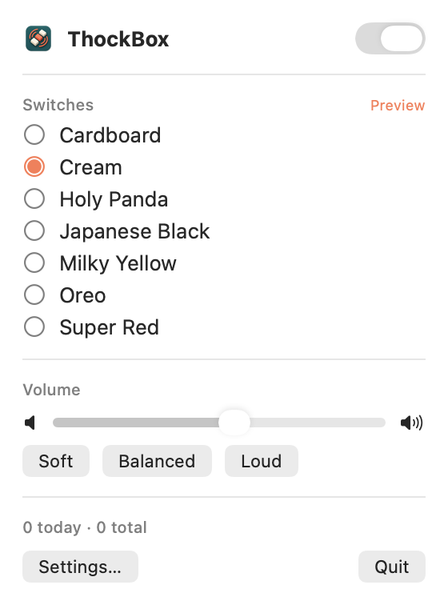
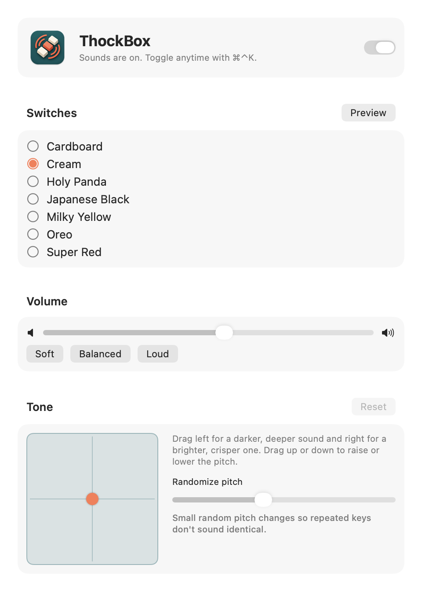

<p align="center">
  
</p>

<h1 align="center">ThockBox</h1>

<p align="center">
  Mechanical keyboard sounds for your Mac.<br>
  A small, native menu bar app that plays a real switch recording on every key press.
</p>

<p align="center">
  <a href="https://github.com/Bruno-Alumn/ThockBox/actions/workflows/test.yml"></a>
  
  <a href="LICENSE"></a>
</p>

<p align="center">
  
  &nbsp;&nbsp;
  
</p>

## Overview

ThockBox sits in the menu bar and plays a switch sound for every key you
type. It ships with seven switch sets, with samples per keyboard row and
separate ones for Space, Return and Backspace. Most sets also have their own
release sounds. Keys are panned by their
position on the keyboard and pitched slightly differently each time, so
typing sounds like a real board rather than one sample on repeat.

It is written in Swift with AppKit, SwiftUI and AVAudioEngine. There is no
network code, no analytics and no keystroke logging.

## Features

| Sound | Control | Automation |
|---|---|---|
| Seven switch sets | ⌘⌃K or option-click to toggle | Mute when the screen locks |
| Press and release samples (most sets) | Volume presets, independent of system volume | Mute after 1 to 60 minutes idle |
| Per-row samples, panned by key position | Choose any output device | Launch at login |
| Tone Pad for darker or brighter sound | Mute modifier or function keys | AppleScript control |
| Random pitch variation | Haptic feedback on Force Touch trackpads | |
| Optional Return ding and mouse clicks | Keystroke counts, today and total | |

Switch sets: Cardboard, Cream, Holy Panda, Japanese Black, Milky Yellow,
Oreo and Super Red.

## Menu bar and settings window

The menu bar panel holds the everyday controls: on and off, switch set,
volume, and today's keystroke count.

**Settings…** (⌘,) opens the settings window with everything else, including
the Tone Pad, key options, automatic mute and output device. While the window
is open ThockBox appears in the Dock; closing the window returns it to the
menu bar. Opening ThockBox from Finder, Launchpad or Spotlight while it is
running also brings up the window.

## Installation

ThockBox is built from source. It needs macOS 13 or later and the Xcode
command line tools.

```sh
git clone https://github.com/Bruno-Alumn/ThockBox.git
cd ThockBox
make            # build dist/ThockBox.app
make run        # open it
```

Copy `dist/ThockBox.app` to Applications to keep it. `make zip` produces a
signed archive, `dist/ThockBox-<version>.zip`, for sharing.

### Accessibility permission

macOS requires Accessibility access for an app to receive key presses from
other apps. On first launch ThockBox opens its settings window and asks for
it. Grant it in System Settings → Privacy & Security → Accessibility.

Builds are ad-hoc signed, and macOS ties the permission to the exact binary.
After rebuilding, reset the permission and grant it again:

```sh
tccutil reset Accessibility io.github.bruno-alumn.thockbox
```

Signing with a developer certificate avoids this:
`make bundle CODESIGN_ID="Apple Development: you@example.com"`.

## Privacy

ThockBox uses key events only to choose and play a sound. It does not record,
store or transmit what you type. The code that receives key events is in
[`KeyListener.swift`](Sources/Thockbox/KeyListener.swift) and is short enough
to read in a few minutes.

## Performance

Measured on Apple Silicon with `make bench`:

| Metric | Value |
|---|---|
| Key press to rendered audio | ~5 ms, plus output device latency |
| CPU per key press | ~1 ms |
| CPU when idle | ~0.5–1% |
| App size | ~2.3 MB |

Bluetooth headphones add their own latency, around 160 ms for AirPods. Built-in
speakers or wired headphones give the most immediate response.

## AppleScript

```applescript
tell application "ThockBox"
    set sounds enabled to false
    set sound pack to "cream" -- pack ID or display name
    set sound volume to 0.55 -- 0.0 to 1.0
end tell
```

## Custom switch sets

Add a folder under `Resources/Sounds/` containing your samples and a
`pack.json`, then run `make bundle`.

```json
{
  "id": "my-pack",
  "name": "My Pack",
  "keys": {
    "default":   {"down": ["press/key1.wav", "press/key2.wav"], "up": ["release/key.wav"]},
    "space":     {"down": ["press/space.wav"], "up": ["release/space.wav"]},
    "enter":     {"down": ["press/enter.wav"]},
    "backspace": {"down": ["press/backspace.wav"]},
    "row0":      {"down": ["press/num_row.wav"]}
  }
}
```

- `default` is required. `space`, `enter`, `backspace` and `row0` to `row4`
  (top to bottom) are optional and fall back to `default`.
- When a list has several files, one is chosen at random for each key press.
- WAV, MP3, CAF, AIFF and M4A are supported.
- Room noise before and after each click is trimmed automatically when the
  pack loads.
- A pack with an invalid `pack.json` or no `default` sounds is skipped, and
  the reason is written to the log.

## Development

```sh
make test     # unit tests, then a smoke test that plays every pack
make bench    # CPU per key press and idle CPU, fails on a large regression
make icon     # rebuild the app icon from art/logo-source.png
make sounds   # rebuild the bundled sound sets (requires uv)
```

CI runs the unit tests and builds the app on every push and pull request. The
smoke test needs an audio output device, so run `make test` locally before
opening a pull request.

### Architecture

- `KeyListener` receives key and mouse events from AppKit.
- `AppState` holds the settings and decides what to play. Keystroke counts
  live in `StatsStore`.
- `SoundEngine` plays samples through AVAudioEngine: eight voices, each with
  its own pitch shifter, into an EQ for the Tone Pad. Samples are decoded
  into memory when a pack loads, so a key press is a single buffer schedule.
- The interface is SwiftUI: `MenuView` for the menu bar, `SettingsView` for
  the settings window.

## Credits

ThockBox began as a fork of
[OpenKlack](https://github.com/amruth-sn/openklack) by Amruth Niranjan. It is
inspired by [Klack](https://tryklack.com/) and is not affiliated with or
endorsed by Klack or its developer.

The switch recordings come from [tplai/kbsim](https://github.com/tplai/kbsim)
and [mechvibes](https://github.com/hainguyents13/mechvibes), both MIT
licensed. See [ATTRIBUTION.md](ATTRIBUTION.md) for details on each set.

## License

MIT. See [LICENSE](LICENSE).
