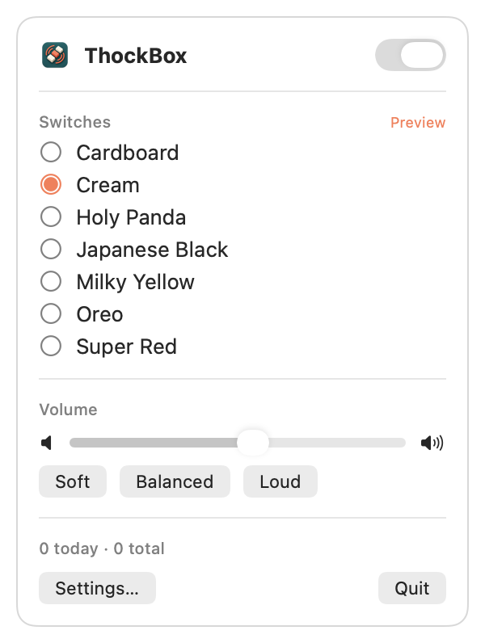

<p align="center">
  
</p>

<h1 align="center">ThockBox</h1>

<p align="center">
  Mechanical keyboard sounds for your Mac.<br>
  A small, native menu bar app that plays a real switch recording on every key press.
</p>

<p align="center">
  <a href="https://github.com/Bruno-Alumn/ThockBox/actions/workflows/test.yml"></a>
  
  <a href="LICENSE"></a>
</p>

<p align="center">
  <picture>
    <source media="(prefers-color-scheme: dark)" srcset="docs/screenshots/menu-dark.png">
    
  </picture>
  &nbsp;
  <picture>
    <source media="(prefers-color-scheme: dark)" srcset="docs/screenshots/settings-dark.png">
    
  </picture>
</p>

## Overview

ThockBox sits in the menu bar and plays a switch sound for every key you
type. It ships with seven switch sets, with samples per keyboard row and
separate ones for Space, Return and Backspace. Most sets also have their own
release sounds. Keys are panned by their position on the keyboard and pitched
slightly differently each time, so typing sounds like a real board rather
than one sample on repeat. Every set plays at the same loudness, so switching
sets doesn't change the volume.

It is written in Swift with AppKit, SwiftUI and AVAudioEngine. There are no
analytics and no keystroke logging. The only network request is the update
check.

## Features

| Sound | Control | Automation |
|---|---|---|
| Seven switch sets, plus your own recordings | ⌃⌘K (or your own shortcut) or option-click to toggle | Mute when the screen locks or during calls |
| Press and release samples (most sets) | Volume presets, remembered per output device | Mute after 1 to 60 minutes idle |
| Per-row samples, panned by key position | Choose any output device | Mute in apps you choose |
| Tone Pad for darker or brighter sound | Mute modifier or function keys | AppleScript control |
| Random pitch variation | Haptic feedback on Force Touch trackpads | Launch at login |
| Optional Return ding and mouse clicks | Keystroke counts, with a chart of the last week | Updates from GitHub releases |

Switch sets: Cardboard, Cream, Holy Panda, Japanese Black, Milky Yellow,
Oreo and Super Red.

## Menu bar and settings window

The menu bar panel holds the everyday controls: on and off, switch set,
volume, a switch to mute the app you were just using, and today's keystroke
count. When sounds are muted automatically, the panel says why.

**Settings…** (⌘,) opens the settings window with everything else: the Tone
Pad, the toggle shortcut and other key options, automatic mute, muted apps,
the output device, launch at login, a chart of the last week's keystrokes,
and updates. While the window is open ThockBox appears in the Dock; closing
the window returns it to the menu bar. Opening ThockBox from Finder,
Launchpad or Spotlight while it is running also brings up the window.

### Automatic mute

ThockBox can go quiet on its own and come back when the reason goes away:

- **During calls:** while another app uses the microphone (macOS 14.2 or
  later). "Hey Siri" and Voice Control are ignored, since they listen all
  the time.
- **When the screen locks.**
- **In muted apps:** while one of the apps you picked is in front.
- **After inactivity:** after 1 to 60 minutes without typing. The next key
  press wakes it.

The menu bar panel shows which one is active.

## Installation

ThockBox is built from source. It needs macOS 13 or later and the Xcode
command line tools.

```sh
git clone https://github.com/Bruno-Alumn/ThockBox.git
cd ThockBox
make            # build dist/ThockBox.app
make run        # open it
```

Copy `dist/ThockBox.app` to Applications to keep it. `make zip` produces a
signed archive, `dist/ThockBox-<version>.zip`, for sharing.

### Accessibility permission

macOS requires Accessibility access for an app to receive key presses from
other apps. On first launch ThockBox opens its settings window and asks for
it. Grant it in System Settings → Privacy & Security → Accessibility.

macOS ties the permission to how the app is signed. Releases are signed with
the same certificate every time, so the permission carries over to new
versions.

If you build ThockBox yourself, run `make signing-cert` once. It creates a
self-signed "ThockBox Signing" certificate in your login keychain, and every
build after that is signed with it, so you grant access once. Without it,
builds are ad-hoc signed and each rebuild needs the permission again:

```sh
tccutil reset Accessibility io.github.bruno-alumn.thockbox
```

You can also sign with a developer certificate:
`make bundle CODESIGN_ID="Apple Development: you@example.com"`.

## Troubleshooting

**No sound at all.** Open the menu bar panel. It shows a notice if
Accessibility access is missing, if sounds are muted automatically and why,
or if another app's secure input is blocking key presses. Also check that
the toggle is on (⌃⌘K by default) and the volume isn't at zero.

**Sound stops in some apps.** While a password field is focused, or while
Terminal's Secure Keyboard Entry is on, macOS doesn't pass key presses to
other apps. That's expected. If it stays that way after you leave the field,
quit and reopen the app the panel names. Also check Settings → Muted apps.

**Sound is late.** Bluetooth headphones add around 100 to 250 ms that no app
can remove. Settings → Output shows the delay for the current device. Built-in
speakers and wired headphones respond within a few milliseconds.

**Access was granted but nothing plays after rebuilding.** Builds made
without the signing certificate get a new identity each time. Run
`make signing-cert` once, or reset the permission as shown under
[Accessibility permission](#accessibility-permission).

## Privacy

ThockBox uses key events only to choose and play a sound. It does not record,
store or transmit what you type. The code that receives key events is in
[`KeyListener.swift`](Sources/Thockbox/KeyListener.swift) and is short enough
to read in a few minutes.

Once a day ThockBox asks the GitHub API for the latest release. The request
contains nothing but the app version. Turn it off in Settings → Updates.

## Updates

When a newer release is out, the menu bar panel says so, and Settings →
Updates offers **Install and Relaunch**. ThockBox downloads the release zip,
checks that it is a correctly signed ThockBox of that version, replaces the
installed copy and reopens. Accessibility access carries over, since every
release is signed with the same certificate.

## Performance

Measured on Apple Silicon with `make bench`:

| Metric | Value |
|---|---|
| Key press to rendered audio | ~5 ms, plus output device latency |
| CPU per key press | ~1 ms |
| CPU while typing | ~0.6% |
| CPU after 30 s without a key | 0% (the audio engine pauses; the next key adds ~8 ms) |
| Memory | ~85 MB |
| App size | ~2.6 MB |

`make test` also launches the built app and fails if its CPU or memory runs
away, and CI runs the same check on every pull request.

Bluetooth headphones add their own latency, around 160 ms for AirPods. Built-in
speakers or wired headphones give the most immediate response.

## AppleScript

```applescript
tell application "ThockBox"
    set sounds enabled to false
    set sound pack to "cream" -- pack ID or display name
    set sound volume to 0.55 -- 0.0 to 1.0
    set mute during calls to true
    get mute reason -- e.g. "Muted in Safari.", or "" when not muted
    get keystrokes today
end tell
```

Read-only: `automatically muted`, `mute reason`, `keystrokes today` and
`keystrokes total`. The first time a script controls ThockBox, macOS asks
whether to allow it.

## Custom switch sets

The quickest way is **Settings → Switches → Add Your Own…**, or dropping a folder onto the switch list. Pick a folder
of recordings (or the files themselves) and it becomes a switch set named
after the folder. Files with *space*, *enter*/*return* or
*backspace*/*delete* in the name play for those keys. Files with *up* or
*release* in the name play when a key is let go. Everything else plays for
any key. Added sets are kept in `~/Library/Application Support/ThockBox/Sounds/`,
so they survive updates, and the button next to one in Settings moves it to
the Trash.

For full control (per-row sounds, a gain trim), add a folder under
`Resources/Sounds/` with your samples and a `pack.json`, then run
`make bundle`.

```json
{
  "id": "my-pack",
  "name": "My Pack",
  "keys": {
    "default":   {"down": ["press/key1.wav", "press/key2.wav"], "up": ["release/key.wav"]},
    "space":     {"down": ["press/space.wav"], "up": ["release/space.wav"]},
    "enter":     {"down": ["press/enter.wav"]},
    "backspace": {"down": ["press/backspace.wav"]},
    "row0":      {"down": ["press/num_row.wav"]}
  }
}
```

- `default` is required. `space`, `enter`, `backspace` and `row0` to `row4`
  (top to bottom) are optional and fall back to `default`.
- When a list has several files, one is chosen at random for each key press.
- WAV, MP3, CAF, AIFF and M4A are supported.
- Room noise before and after each click is trimmed automatically when the
  pack loads.
- A pack with an invalid `pack.json` or no `default` sounds is skipped, and
  the reason is written to the log.

## Development

```sh
make test          # unit tests, a smoke test that plays every pack, and a launch check
make bench         # CPU per key press and idle CPU (typing and paused), fails on a regression
make icon          # rebuild the app icon from art/logo-source.png
make sounds        # rebuild the bundled sound sets (requires uv)
make signing-cert  # one-time: create the certificate builds are signed with
make release       # publish dist/ThockBox-<version>.zip as a GitHub release (requires gh)
```

CI runs the unit tests and builds the app on every push and pull request. The
smoke test needs an audio output device, so run `make test` locally before
opening a pull request.

### Architecture

- `KeyListener` receives key and mouse events from AppKit.
- `AppState` holds the settings and decides what to play. Keystroke counts
  live in `StatsStore`.
- `SoundEngine` plays samples through AVAudioEngine: eight voices, each with
  its own pitch shifter, into an EQ for the Tone Pad. Samples are decoded
  into memory when a pack loads, so a key press is a single buffer schedule.
- The interface is SwiftUI: `MenuView` for the menu bar, `SettingsView` for
  the settings window.

## Credits

ThockBox began as a fork of
[OpenKlack](https://github.com/amruth-sn/openklack) by Amruth Niranjan. It is
inspired by [Klack](https://tryklack.com/) and is not affiliated with or
endorsed by Klack or its developer.

The switch recordings come from [tplai/kbsim](https://github.com/tplai/kbsim)
and [mechvibes](https://github.com/hainguyents13/mechvibes), both MIT
licensed. See [ATTRIBUTION.md](ATTRIBUTION.md) for details on each set.

## License

MIT. See [LICENSE](LICENSE).
