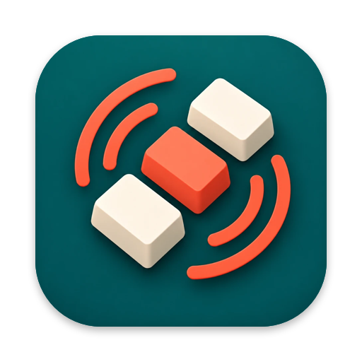
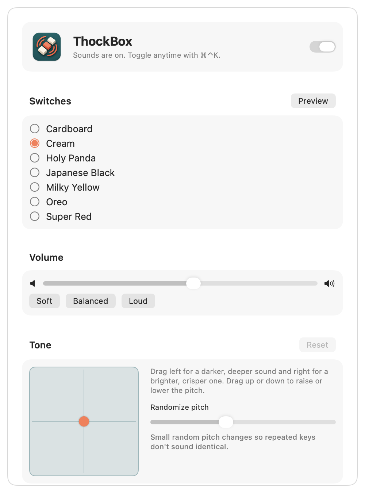

<div align="center">



# ThockBox

**Every keystroke, a real switch.**

A small, native menu bar app that plays a recorded mechanical switch each time you press a key.

<a href="https://github.com/Bruno-Alumn/ThockBox/releases/latest"></a>

<a href="https://github.com/Bruno-Alumn/ThockBox/releases/latest"></a>

<a href="LICENSE"></a>
<a href="https://github.com/Bruno-Alumn/ThockBox/actions/workflows/test.yml"></a>

[Features](#features) · [Install](#install) · [Using ThockBox](#using-thockbox) · [Troubleshooting](#troubleshooting) · [Privacy](#privacy) · [Contribute](#contribute)

</div>

---

ThockBox sits in your menu bar and answers every key you press with the sound
of a real mechanical switch. Each row of the keyboard has its own recordings,
keys are panned to where they sit on the board, and no two presses sound
quite the same, so typing on a laptop feels like typing on a board you built.

<div align="center">
  <picture>
    <source media="(prefers-color-scheme: dark)" srcset="docs/screenshots/settings-dark.png">
    
  </picture>
</div>

ThockBox began as a fork of [OpenKlack](https://github.com/amruth-sn/openklack)
and is inspired by [Klack](https://tryklack.com/). It is not affiliated with
or endorsed by Klack or its developer.

## Features

**Sound that feels real**

- Seven recorded switch sets: Cardboard, Cream, Holy Panda, Japanese Black,
  Milky Yellow, Oreo and Super Red.
- Separate sounds per keyboard row and for Space, Return and Backspace, and
  in most sets for releasing a key.
- Subtle pitch variation and stereo position, so typing never sounds looped.
- Brightness and pitch controls to tune any set to your taste.
- A different set for particular apps, say a quieter one in Terminal, or a
  new set each day.
- Spatial audio on headphones places each key around you, and with AirPods
  the keys stay put as you turn your head.

**Quiet when it should be**

- Mutes itself during calls, meetings and games, while other apps play
  sound or you share your screen, when the screen locks, on speakers, or in
  apps you choose.
- Turn it off for 15 minutes, an hour, four hours or until 8 am; it comes
  back by itself.
- Or make a click on the menu bar icon turn sounds on or off.
- Toggle anywhere with <kbd>⌃</kbd><kbd>⌘</kbd><kbd>K</kbd>, Shortcuts or AppleScript.

**Yours to shape**

- Add Mechvibes packs or your own recordings by dropping a folder in.
- Plays within about 5 ms and uses no CPU about 30 seconds after you stop
  typing.

## Install

1. Download `ThockBox-<version>.dmg` from the
   [latest release](https://github.com/Bruno-Alumn/ThockBox/releases/latest).
2. Open it and drag **ThockBox** into **Applications**.
3. Launch it and grant the [Accessibility permission](#permissions) it asks for.

ThockBox runs on macOS 13 or later and updates itself from new releases.

Releases are signed with a Developer ID and notarized by Apple, and your
permissions carry over from one version to the next.

With Homebrew:

```sh
brew install --cask bruno-alumn/thockbox/thockbox
```

## Using ThockBox

1. Start typing. ThockBox plays from the moment access is granted.
2. Click the menu bar icon to switch sets, change the volume or turn it off.
3. Open **Settings…** to tune the tone, choose an output device and set when
   ThockBox mutes itself.

| Action | What it does |
|:--|:--|
| <kbd>⌃</kbd><kbd>⌘</kbd><kbd>K</kbd> | Turn sounds on or off (change it in Settings › Keys) |
| <kbd>⌥</kbd>-click the menu bar icon | Turn sounds on or off |
| Click the menu bar icon | Today's keystrokes, switch set, volume, mute in this app, turn off for a while |
| <kbd>⌘</kbd><kbd>,</kbd> in the menu | Open Settings |

The first line of the menu always says what ThockBox is doing: playing, off,
or muted and why.

### Your own switch sets

Choose **Settings › Sound › Add Your Own…**, or drop a folder onto the switch
list. ThockBox reads [Mechvibes](https://github.com/hainguyents13/mechvibes)
packs, sets exported from ThockBox, and plain folders of recordings: files
named with *space*, *return* or *backspace* play for those keys, files named
with *up* or *release* play when a key is let go. Added sets are trimmed and
loudness-matched like the built-in ones, and survive updates.

<details>
<summary><strong>Settings, page by page</strong></summary>
<br>

- **Sound:** on and off, the switch set with a field to try it, volume,
  output device, spatial audio on headphones (following your head with
  AirPods), tone (brightness, pitch and variation) and sets for specific
  apps.
- **Keys:** shortcuts for on/off, the next switch set and volume, which keys play (and key releases, keys typed by other apps, mouse clicks and scrolling), the
  Return ding, and a trackpad tap with each key.
- **Muting:** during calls and while other apps play sound (both macOS 14.2
  or later), during calendar events (from the calendars you pick), in games,
  while the screen is shared or recorded; during quiet hours, when the screen
  is locked, when playing on speakers, and after 1 to 60 minutes without
  typing; in apps you choose (or everywhere but them); and at places you save
  (or everywhere but them), which macOS watches using very little battery.
- **Activity:** keystrokes today (and by hour), in total, over the last week, your best day,
  daily average and streak, today's
  typing speed, and a
  CSV export of the last 30 days.
- **General:** login, the menu bar icon (dimmed while sounds are off, if you
  like, and today's keystrokes or typing speed beside it), the app icon
  (Color, Graphite or Graphite while sounds are off),
  a notification when an automation changes the switch set, updates, and
  help, including the Welcome and What's New windows and exporting settings
  to another Mac.

</details>

<details>
<summary><strong>Shortcuts and AppleScript</strong></summary>
<br>

The Shortcuts app gets **Turn ThockBox Sounds On or Off**, **Toggle ThockBox
Sounds**, **Turn Off ThockBox Sounds for a While**, **Set ThockBox Switch
Set**, **Next ThockBox Switch Set**, **Set ThockBox Volume** and **Get ThockBox
Typing Stats** (keystrokes today or in total, today's speed, days in a row). Use them in an automation, or say
“Toggle ThockBox sounds” to Siri. To see when one of them, or a Focus, picks a different switch set,
turn on Settings › General › Notify when the switch set changes.

For a Focus, add ThockBox under **System Settings › Focus › (a Focus) › Focus
Filters**: sounds off, or a different switch set, while that Focus is on.
When the Focus ends, ThockBox goes back to how it was.

```applescript
tell application "ThockBox"
    set sounds enabled to false
    set sound pack to "cream" -- pack ID or display name
    set sound volume to 0.55 -- 0.0 to 1.0
    set mute during calls to true
    set headphones only to true
    set scroll sounds to true -- also mouse clicks, return ding
    set mute after idle to 15 -- minutes: 0, 1, 5, 15, 30 or 60
    set off until to (current date) + 30 * minutes -- back on by itself
    get mute reason -- e.g. "Muted in Safari.", or "" when not muted
    get keystrokes today
end tell
```

Read-only: `automatically muted`, `mute reason`, `keystrokes today` and
`keystrokes total`. Setting `off until` to `missing value` turns sounds back
on.

</details>

## Troubleshooting

<details>
<summary><strong>No sound at all</strong></summary>

Open the menu bar menu. Its first line says if Accessibility access is
missing, if ThockBox muted itself and why, or if another app’s secure input
is blocking key presses. Also check that sounds are on
(<kbd>⌃</kbd><kbd>⌘</kbd><kbd>K</kbd>) and the volume isn’t at zero.

If ThockBox is switched on in System Settings › Privacy & Security ›
Accessibility but the menu still says access is needed, open Settings and
click **Reset…** next to Open System Settings at the top of the page, then
allow it again when asked.
</details>

<details>
<summary><strong>Sound stops in some apps</strong></summary>

While a password field is focused, or Terminal’s Secure Keyboard Entry is on,
macOS doesn’t pass key presses to other apps. If it stays quiet after you
leave the field, quit and reopen the app the menu names. Also check
Settings › Muting.
</details>

<details>
<summary><strong>It goes quiet when I don't expect it</strong></summary>

The menu bar menu's first line names the reason, for example "Muted during a
calendar event" or "Muted while media plays". Each one is a switch in
Settings › Muting: calls, calendar events, other apps playing sound, games,
screen sharing, a locked screen, quiet hours, speakers, chosen apps, places
and idle time. A Focus filter can also turn sounds off while that Focus is
on. If it says "Muted while
… plays" and nothing is playing, uncheck that app under Settings › Muting ›
Playing now: some apps keep their sound open while silent. Play Anyway in
the menu plays through a mute until its reason ends.
</details>

<details>
<summary><strong>Sound arrives late</strong></summary>

Bluetooth headphones add about 100 to 250 ms that no app can remove. When the
delay is noticeable, Settings › Sound shows it under **Play through**. Built-in speakers
and wired headphones respond within a few milliseconds.
</details>

<details>
<summary><strong>Something else</strong></summary>

**Settings › General › Report a Problem…** opens a new issue with your
ThockBox and macOS versions filled in.
</details>

## Privacy

ThockBox has no accounts, analytics or keystroke logging. It uses each key
press only to choose a sound, and never records, stores or sends what you
type. The code that receives key events is in
[`KeyListener.swift`](Sources/Thockbox/KeyListener.swift), short enough to
read in a few minutes.

Its only network request is a daily update check with GitHub, which sends
nothing but the app version. Turn it off in Settings › General.

### Permissions

| Permission | Why it’s needed |
|:--|:--|
| **Accessibility** | Lets ThockBox hear key presses in other apps so it can play a sound for each one. |

## Contribute

- **Found something broken?** Use **Settings › General › Report a Problem…**,
  or [open an issue](https://github.com/Bruno-Alumn/ThockBox/issues/new).
- **Want to help?** Fork the repository and open a pull request against `main`.
  Run `make test` first: CI can’t run the sound smoke test without an audio
  device.

Much of ThockBox was built with AI coding agents, then compiled, tested and
exercised on real hardware before merging. AI-assisted contributions are
welcome on the same terms as any other: say what you changed and be honest
about what you tested.

<details>
<summary><strong>Build from source</strong></summary>
<br>

You need the Xcode command line tools.

```sh
git clone https://github.com/Bruno-Alumn/ThockBox.git
cd ThockBox
make signing-cert   # once: lets every build keep its Accessibility permission
make run            # build dist/ThockBox.app and open it
```

Without `make signing-cert`, builds are ad-hoc signed and each rebuild needs
the permission again (`tccutil reset Accessibility io.github.bruno-alumn.thockbox`).

```sh
make test     # unit tests, a smoke test that plays every pack, and a launch check
make bench    # CPU per key press and idle CPU; fails on a regression
make sounds   # rebuild the bundled sound sets (requires uv)
make icon     # rebuild the app icon from art/logo-source.png
make dmg      # dist/ThockBox-<version>.dmg
make cask     # point the Homebrew cask at this version
make release  # publish the disk image as a GitHub release (requires gh)
```

How releases are signed, notarized and published: [docs/RELEASING.md](docs/RELEASING.md).

</details>

<details>
<summary><strong>Architecture</strong></summary>
<br>

- `KeyListener` receives key and mouse events from AppKit.
- `AppState` holds the settings and decides what to play; `StatsStore` keeps
  keystroke counts.
- `SoundEngine` plays samples through AVAudioEngine: eight voices, each with
  its own pitch shifter, into an EQ for the tone controls. Samples are decoded
  when a pack loads, so a key press is a single buffer schedule.
- `MenuView` and `SettingsView` are SwiftUI and both show `AppState.status`,
  so they always agree on what’s happening.

</details>

<details>
<summary><strong>Switch set format</strong></summary>
<br>

For per-row sounds or a gain trim, add a folder under `Resources/Sounds/`
with your samples and a `pack.json`, then run `make bundle`.

```json
{
  "id": "my-pack",
  "name": "My Pack",
  "keys": {
    "default":   {"down": ["press/key1.wav", "press/key2.wav"], "up": ["release/key.wav"]},
    "space":     {"down": ["press/space.wav"], "up": ["release/space.wav"]},
    "enter":     {"down": ["press/enter.wav"]},
    "backspace": {"down": ["press/backspace.wav"]},
    "row0":      {"down": ["press/num_row.wav"]}
  }
}
```

`default` is required; `space`, `enter`, `backspace` and `row0` to `row4`
(top to bottom) fall back to it. Several files in a list are picked at
random. WAV, MP3, CAF, AIFF and M4A all work. A pack with an invalid
`pack.json` is skipped and the reason logged.

</details>

<details>
<summary><strong>Performance</strong></summary>
<br>

Measured on Apple Silicon with `make bench`:

| Metric | Value |
|---|---|
| Key press to sound | about 5 ms, plus the output device |
| CPU while typing | about 0.6% |
| CPU after 30 s idle | 0% (the next key adds about 8 ms) |
| Memory | about 26 MB |
| App size | about 2.8 MB |

</details>

<details>
<summary><strong>Project documentation</strong></summary>
<br>

| Document | What’s inside |
|:--|:--|
| [Changelog](CHANGELOG.md) | What changed in each version |
| [Attribution](ATTRIBUTION.md) | Where each switch set’s recordings come from |

</details>

---

ThockBox began as a fork of [OpenKlack](https://github.com/amruth-sn/openklack)
by Amruth Niranjan. The switch recordings come from
[tplai/kbsim](https://github.com/tplai/kbsim) and
[mechvibes](https://github.com/hainguyents13/mechvibes), both MIT licensed.

**MIT License:** OpenKlack © 2026 Amruth Niranjan and contributors; ThockBox
changes © 2026 Bruno-Alumn. See [LICENSE](LICENSE) and
[ATTRIBUTION.md](ATTRIBUTION.md).

<sub>More Mac apps by Bruno-Alumn: [SolStream](https://github.com/Bruno-Alumn/SolStream) · [Tuckaway](https://github.com/Bruno-Alumn/Tuckaway)</sub>
